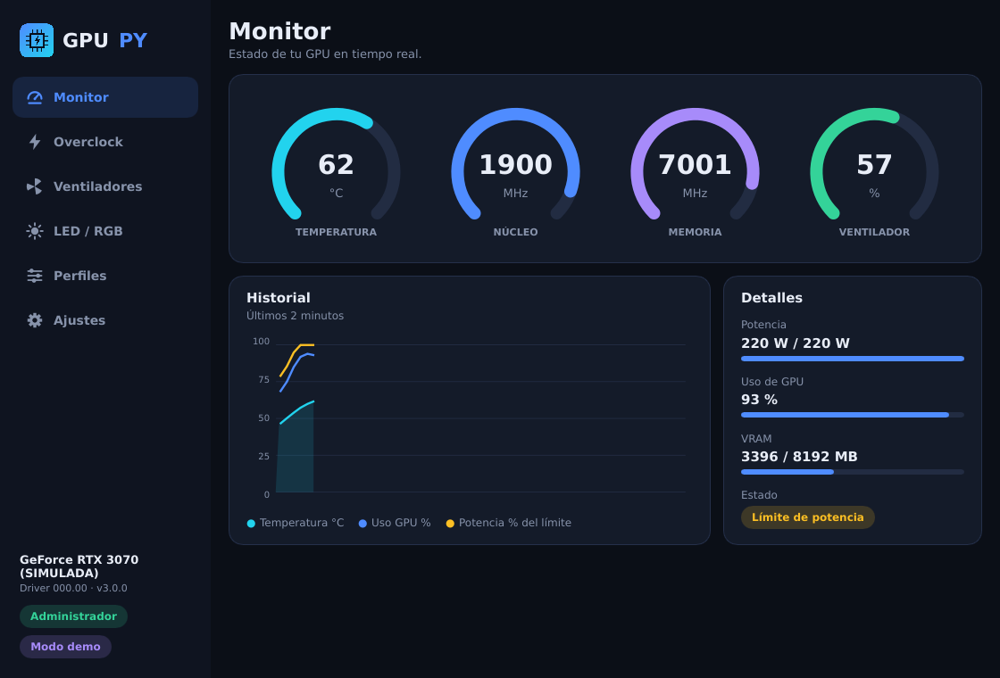
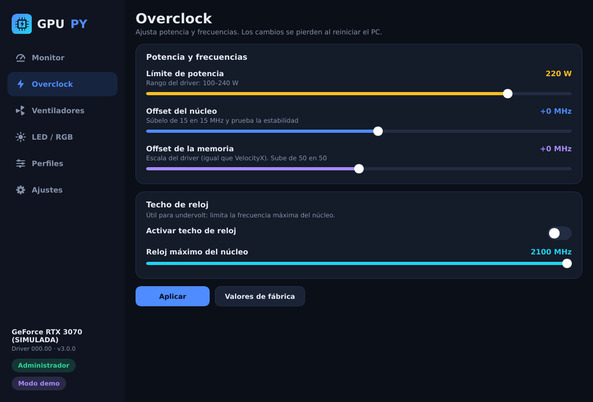
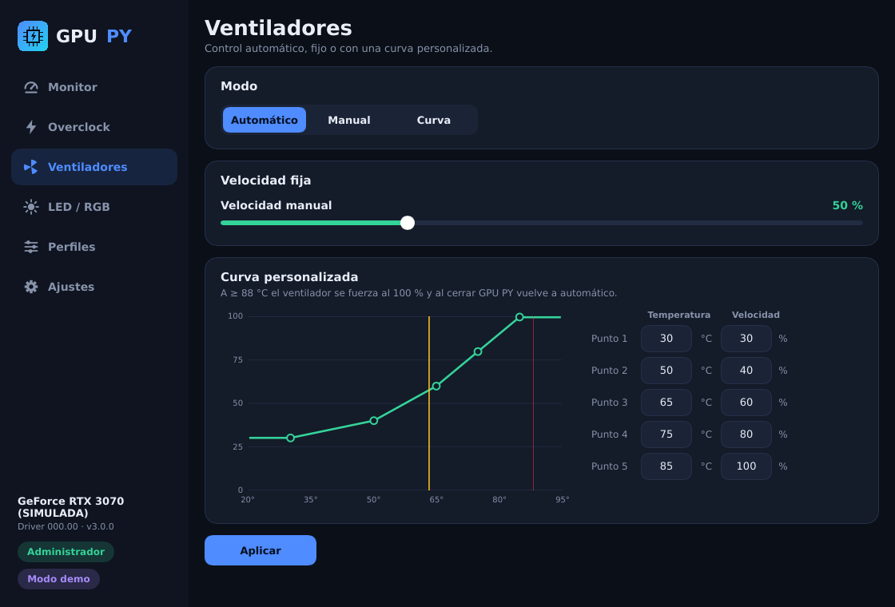
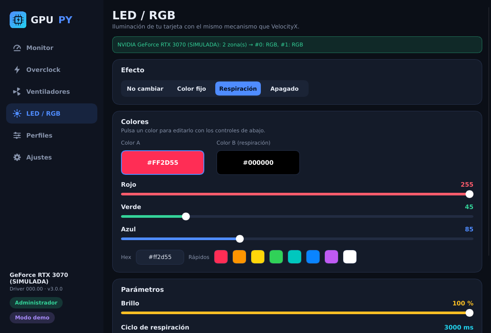
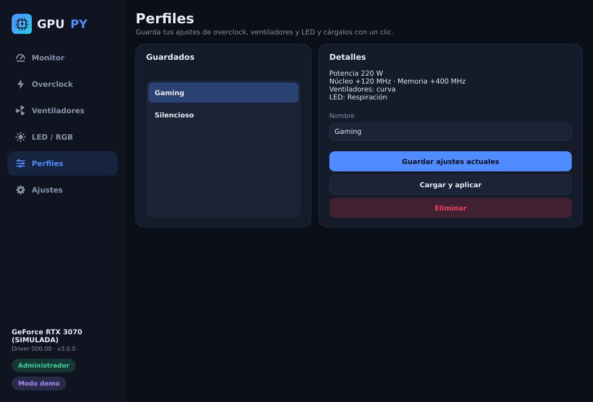

# GPU PY (Rust + Slint)

Monitor, overclock, ventiladores y LED/RGB para GPUs NVIDIA — alternativa a PNY VelocityX.
Migración completa de [PachiMc/GPU-PY](https://github.com/PachiMc/GPU-PY) de Python/customtkinter a **Rust + Slint**.



|  |  |
|---|---|
|  |  |
|  |  |

> Las capturas están renderizadas en Linux con el renderizador por software y una fuente de reserva
> (no hay Segoe UI). En Windows se verá con Segoe UI y aceleración por GPU.

## Qué ganas con la migración

- Un solo `.exe` nativo (sin Python, sin PyInstaller, sin `customtkinter`/`pystray`/`pillow`).
- Arranque instantáneo y consumo mínimo en la bandeja.
- Todo el trabajo con NVAPI/I2C usa estructuras `#[repr(C)]` con **comprobaciones en tiempo de compilación**
  de tamaños y desplazamientos (`size_of`/`offset_of`), en lugar de `ctypes` + `assert` en ejecución.
- Pruebas automáticas, incluida una **comparación byte a byte contra tu código Python original** (ver abajo).

## Compilar

Requisitos: Rust ≥ 1.92 (`rustup update stable`) y, en Windows, las *Build Tools* de Visual Studio (las mismas que pide `rustup`).

```powershell
cargo run -- --demo          # interfaz con una GPU simulada (no necesita tarjeta NVIDIA)
cargo run                    # interfaz con tu GPU
cargo build --release        # → target\release\gpu-py.exe  (pide Administrador al abrir)
cargo test                   # pruebas
```

El `.exe` de release lleva icono y manifiesto de UAC (`requireAdministrator`) igual que el `--uac-admin` de
PyInstaller. En debug no pide elevación, para poder usar `cargo run`.

`.github/workflows/build.yml` compila y prueba en Windows y Linux, y adjunta el `.exe` a las releases con tag `v*`.

> `Cargo.lock` está incluido (Slint **1.18.1** y el resto en su última versión a la fecha). Todas las
> dependencias están en su última versión; para actualizar en el futuro: `cargo update`.
> El perfil de desarrollo optimiza las dependencias (`opt-level = 3`), así que la **primera** compilación en
> debug tarda más, pero la interfaz va fluida también con `cargo run`.

## Uso

Igual que antes. Sin argumentos abre la interfaz; con argumentos funciona como CLI:

```
gpu-py --list                    gpu-py --apply "Gaming"          gpu-py --reset
gpu-py --led "#ff0066"|off|default                                gpu-py --led-info
gpu-py --oc-info                 gpu-py --i2c-scan                gpu-py --demo
gpu-py --autostart on|off|status gpu-py --install
```

Los datos siguen en `%APPDATA%\GPU PY` (`profiles.json`, `settings.json`): **tus perfiles de la versión Python
se leen tal cual** (probado con JSON en el formato que escribe el código Python; no con un archivo real tuyo).

## Correspondencia con el código original

| Python | Rust | Notas |
|---|---|---|
| `gpu_backend.py` (pynvml + demo) | `src/backend/{mod,nvml,demo}.rs` | `nvml-wrapper`; el rango de offsets VF se pide con `libloading` |
| `oc_nvapi.py` | `src/nvapi/oc.rs` | Pstates20 y power policies, mismos offsets |
| `led_nvapi.py` | `src/nvapi/illum.rs` + `raw.rs` | zonas de iluminación y carga de `nvapi64.dll` |
| `led_i2c.py` | `src/nvapi/i2c.rs` | misma lista blanca de registros |
| `core.py` | `src/core.rs` | perfiles, ajustes, aplicar, detección |
| `autostart.py`, `install.py` | `src/autostart.rs`, `src/install.rs` | tarea programada por XML UTF‑16 |
| `tray.py` | `src/tray.rs` | crate `tray-icon` |
| `ui.py`, `widgets.py`, `theme.py`, `icons.py` | `ui/*.slint` + `src/app.rs` | diseño declarativo Slint |
| `gpupy.py` | `src/cli.rs`, `src/main.rs` | `clap` |

## Arreglo del LED «colgado» (restaurar y luego aplicar)

En el original, al pasar de **Respiración** a **Color fijo** solo se reescribían unos pocos registros
(I2C: `0x60` y `0x6C–0x6F`; zonas NVAPI: los 4 primeros bytes), de modo que los parámetros del efecto anterior
quedaban en el controlador. «Restaurar» limpiaba ese estado, por eso funcionaba aplicar después.

El port ahora:

1. **Limpia** el estado previo antes de un color fijo (zonas NVAPI: pone a cero los datos; I2C: para el efecto,
   el mismo paso que hace «Restaurar»).
2. **Lee de vuelta** y, si el controlador no se quedó con el cambio, hace automáticamente el ciclo
   restaurar → aplicar. En I2C solo lee y repite la escritura de los mismos registros.

Es una **hipótesis basada en el código**; no la he podido comprobar en tu tarjeta. Está probada con controladores
simulados que «pierden» una escritura (`tests/led_fix.rs`, que además reproduce el fallo con
`legacy_behavior = true`). Si en tu GPU sigue ocurriendo, ejecuta `gpu-py --led-info` y `gpu-py --i2c-scan` y
revisa `led_report.txt`.

## Si no se abre al iniciar Windows

1. **Mira la bandeja.** Por defecto «Iniciar minimizado» y «Bandeja» están activados: al iniciar sesión GPU PY arranca
   *sin ventana*, solo con su icono junto al reloj (suele quedar dentro de «^»). Clic en el icono para abrirla.
2. Ejecuta `gpu-py --autostart status`. Muestra el ejecutable al que apunta la tarea y avisa si **ya no existe**
   (se movió, se borró la descarga o se recompiló en otra carpeta). Si lo abres con la ventana, GPU PY detecta esa
   situación y ofrece repararla. Reactivar el interruptor «Iniciar GPU PY al iniciar sesión» también la rehace.
3. Revisa `%APPDATA%\GPU PY\startup.log`: registra cada arranque (argumentos, NVML, bandeja, perfil de inicio)
   y **cualquier fallo o pánico**. Si sigue sin abrir, ese archivo y la salida de `--autostart status` dicen por qué.

Correcciones de esta versión en el arranque con Windows:

- La ventana se guardaba con una referencia débil; si no estaba visible (arranque oculto o enviada a la bandeja) se
  destruía y el primer temporizador abortaba el programa **sin mensaje** (`panic = "abort"`, sin consola).
- Si el icono de bandeja no podía crearse al iniciar sesión (el Explorador aún no tiene barra de tareas), la ventana
  quedaba oculta y sin icono: ahora se muestra minimizada y se reintenta crear el icono cada 2 s.
- NVML se reintenta hasta ~35 s al iniciar sesión (el driver puede no estar listo) y el LED se vuelve a detectar al
  reintentar el perfil de inicio.
- Una sola instancia: si la de la bandeja ya está en marcha, abrir otra avisa en vez de duplicar el control de GPU.

## Rendimiento

Auditoría y cambios (la causa más probable de que redimensionar se entrecortara era ejecutar en debug sin optimizar):

- **Perfil de desarrollo optimizado** para Slint y el resto de dependencias (`Cargo.toml`). Para uso diario, `--release`.
- **NVML en otro hilo** (`src/reader.rs`): la interfaz solo lee la última muestra, nunca espera al driver.
  Con la ventana en la bandeja se lee cada 5 s.
- **Gráfica del historial más ligera**: ~60 puntos por serie, sin uniones redondeadas y un solo relleno.
  Los trazos vectoriales se vuelven a teselar en cada fotograma, así que menos geometría = redimensionar más fluido.
- **Sin `opacity` enlazado** en slider/interruptor/botón (puede forzar capas de dibujo aparte); los estados
  deshabilitados se resuelven con colores.
- **Aviso y diálogo con altura determinista**: el aviso mide el texto en una línea y su alto es 1, 2 o 3 líneas;
  el diálogo limita el mensaje a 260 px con desplazamiento. Ya no dependen de medir texto con saltos de línea.
- Esc cierra el diálogo y Enter lo acepta.

Si aun así notas tirones en Windows, prueba otro renderizador: `set SLINT_BACKEND=winit-software` (o `winit-femtovg`) y
cuéntame cuál va mejor. `cargo run --release --example perf` mide el coste por página.

## Pruebas

```
cargo test
```

- `tests/golden.rs` — **comparación diferencial con el Python original**: `scripts/gen_golden.py` ejecuta tus
  `led_i2c.py`, `led_nvapi.py`, `oc_nvapi.py` y `core.py` y guarda los resultados en `tests/golden/golden.json`
  (secuencias exactas de escrituras I2C, bytes de las estructuras de zonas, lecturas/escrituras de Pstates20 y de
  potencia con sus errores, interpolación de la curva). Rust debe reproducirlos idénticos. Para regenerar:
  `python3 scripts/gen_golden.py /ruta/a/GPU-PY`.
- `tests/led_fix.rs` — el arreglo del LED y que **nunca** se escribe fuera de la lista blanca de registros.
- `tests/core.rs` — perfiles (formato Python, campos ausentes, archivo corrupto con copia `.bak`), demo, gráficas.
- `tests/startup.rs` — arranque con `--startup` sin bandeja: la ventana no queda invisible y los temporizadores siguen vivos con la ventana oculta.
- Pruebas unitarias de autostart (XML, lectura de la tarea, tarea rota), registro, instalación y el lector de telemetría.

`cargo run --example screenshot` renderiza todas las páginas a PNG sin necesidad de ventana
(`GPUPY_SCREENSHOT=1 cargo run --example screenshot -- ./capturas`).

## Qué NO he podido verificar (léelo antes de usarlo)

Se desarrolló en Linux, sin Windows ni GPU NVIDIA. Esto **compila y pasa pruebas en Linux**, pero:

- **Nunca se compiló ni ejecutó el código específico de Windows**: carga de `nvapi64.dll`, llamadas reales a NVAPI/I2C,
  bandeja del sistema, enganche de la consola para la CLI, manifiesto de UAC, `schtasks`, instalación. Puede haber
  errores de compilación o de ejecución ahí; el workflow de GitHub Actions lo dirá en el primer push.
- **El backend NVML real compila pero no se ha ejecutado** (no había GPU). El resto se probó con la GPU simulada.
- **Nada se ha probado contra hardware real.** Las estructuras se verifican contra el código Python original, que a su
  vez se dedujo de VelocityX; el riesgo de fondo es el mismo que ya tenía el proyecto.
- La interfaz se revisó visualmente solo con el renderizador por software en Linux.

Sugerencia para la primera prueba en tu PC: `gpu-py --oc-info`, `gpu-py --led-info`, luego la interfaz en `--demo`,
y después cambios pequeños (potencia/offset) comprobando la temperatura.

## Diferencias respecto a la versión Python

- **Selector de color del LED**: sliders RGB + campo hex + colores rápidos (en vez del selector HSV).
- **Notificaciones** del globo de la bandeja: no hay (los avisos se muestran dentro de la ventana).
- **Minimizar → bandeja** se detecta por sondeo cada 250 ms (Slint no emite un evento de minimizado).
- Zonas de LED: casillas por zona (hasta 32).
- Versión **3.0.1**.

## Licencia

MIT, como el proyecto original.
