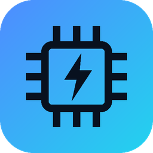

# GPU PY 🚀

> Monitor, overclock, ventiladores y LED/RGB para GPUs NVIDIA — alternativa en Python a PNY VelocityX, con interfaz moderna.


Pensado para la **RTX 3070 PNY XLR8** (y otras GeForce). Monitorea temperatura, relojes, ventilador, potencia, uso, VRAM y throttling con historial, y permite aplicar overclock, curvas de ventilación y efectos LED de forma segura.



## ⬇️ Descarga (recomendado)

No necesitas instalar Python. Descarga el ejecutable listo para usar:

👉 **[Descargar GPU-PY.exe (última release)](https://github.com/PachiMc/GPU-PY/releases/latest/download/GPU-PY.exe)**

1. Descarga `GPU-PY.exe`.
2. Doble clic (Windows pedirá **Administrador** automáticamente, necesario para aplicar cambios).
3. Listo: la app se abre y puedes monitorear tu GPU.

> ¿Prefieres compilarlo tú? Mira [🛠️ Compilar el .exe](#️-compilar-el-exe).

## ✨ Funciones

| Función | Detalle |
|---|---|
| 📊 Monitor | Temperatura, relojes, ventilador, potencia, uso, VRAM y motivo de throttling, con historial |
| ⚡ Overclock | Offsets de núcleo y memoria, límite de potencia y techo de reloj; por NVML o **NVAPI** (como VelocityX) |
| 🌀 Ventiladores | Automático, fijo o curva personalizada con vista previa (a ≥ 88 °C fuerza 100 %) |
| 🌈 LED / RGB | Color fijo, respiración, apagado y —según tu controlador— ciclo y estrobo; por NVAPI o I2C (como VelocityX) |
| 💾 Perfiles | Guarda y aplica overclock + ventiladores + LED con un clic, también desde consola |
| 🚀 Inicio con Windows | Aplica tu perfil automáticamente al iniciar sesión (tarea programada con máximos privilegios) |
| 🔕 Bandeja (tray) | Minimizar y la X llevan a la bandeja (clic para mostrar, clic derecho para salir); oculto mide cada 5 s |

## 🚀 Uso desde código fuente (Windows)

1. Instala **Python 3.10 o superior** desde [python.org](https://www.python.org/downloads/) (marca *Add python.exe to PATH*).
2. En esta carpeta:
   ```bat
   pip install -r requirements.txt
   ```
3. Prueba sin riesgo con una GPU simulada:
   ```bat
   python gpupy.py --demo
   ```
4. Uso real (los cambios requieren Administrador): doble clic en **`run_as_admin.bat`**.

### ▶️ Iniciar con Windows

En **Ajustes** activa *Iniciar GPU PY al iniciar sesión* (con la app abierta como Administrador):

- Crea una tarea del Programador de tareas con **máximos privilegios** (Windows no pide permiso cada vez).
- Opcional: *Iniciar minimizado* + *Perfil al iniciar* (aplica overclock, ventiladores y LED automáticamente). Con *Bandeja del sistema* activado, arranca directamente en el tray.
- Si el driver tarda en estar listo, GPU PY reintenta aplicar el perfil hasta 3 veces.
- Sin interfaz:
  ```bat
  python gpupy.py --autostart on|off|status
  ```

## ⌨️ Línea de comandos

```bat
python gpupy.py --list                  perfiles guardados
python gpupy.py --apply Gaming          aplica un perfil y sale
python gpupy.py --reset                 valores de fábrica
python gpupy.py --led "#ff0066"         color fijo (también: off | default)
python gpupy.py --led-info              controlador LED detectado
python gpupy.py --i2c-scan              diagnóstico de solo lectura del LED (guarda led_report.txt)
python gpupy.py --oc-info               qué overclock permite tu GPU (solo lectura)
```

Los perfiles y ajustes se guardan en `%APPDATA%\GPU PY` (migra solos los de versiones anteriores).

## 🛠️ Compilar el .exe

Para generar tu propio ejecutable (un solo archivo, con icono, pide Administrador al abrir):

```bat
build_exe.bat
```

Saldrá en `dist\GPU PY.exe`. Equivale a:

```bat
python -m pip install -r requirements.txt pyinstaller
python -m PyInstaller --noconfirm --onefile --windowed --uac-admin --name "GPU PY" ^
  --icon assets\gpupy.ico --add-data "assets;assets" --collect-all customtkinter --collect-all pystray gpupy.py
```

## 📁 Estructura

- `gpupy.py` — punto de entrada y línea de comandos
- `ui.py` — ventana principal y páginas · `widgets.py` — componentes · `theme.py` — diseño · `icons.py` — iconos
- `core.py` — perfiles, ajustes y lógica · `autostart.py` — inicio con Windows · `tray.py` — icono en la bandeja
- `gpu_backend.py` (NVML) · `oc_nvapi.py` · `led_nvapi.py` · `led_i2c.py` — acceso al hardware

## ⚠️ Seguridad y notas

- Los cambios de overclock y LED **no son permanentes**: se pierden al reiniciar. Por eso existe el perfil de inicio.
- Sube los offsets poco a poco (núcleo de 15 en 15 MHz, memoria de 50 en 50) y prueba estabilidad.
- El LED por I2C solo escribe los registros exactos que usa VelocityX (lista blanca), nunca toca otros chips.
- En muchas GeForce el driver puede rechazar el control de ventiladores; la app lo avisa y los deja en automático.
- Al cerrar GPU PY, el ventilador siempre vuelve a automático.
- La escala de velocidad de ciclo/estrobo es el valor crudo del controlador (1–100).

## 📄 Licencia

MIT — úsalo, modifícalo y compártelo libremente. Sin garantía; el overclock siempre es bajo tu responsabilidad.
